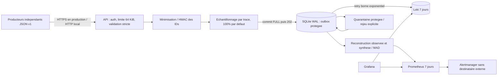

# Architecture et decisions

Audit du 2 novembre, execution du 3 novembre 2026. Depot Services initialement vide sans commit. Project Twin sur `codex/structuration-logs-local` : seul changement etranger constate dans `backend/app/modules/identity/authorization.py`. Aucun fichier applicatif modifie. Pas d'AGENTS.md trouve aux racines et chemins inspectes. Sources inspectees : logging.py, middleware.py, debut et logique HTTP/sondes d'observability.py ; app.py du gateway (validation, protection, outbox, worker), compose observability, requirements observability, README et VALIDATION. Les six tests historiques et preuves annoncees sont du contexte documentaire ; ils ne remplacent pas les nouveaux essais.

Le JSON Schema est le seul contrat producteur ; aucun import de FastAPI ou Project Twin n'est exige pour emettre. `service.name` est une liste initiale explicite : l'ouvrir a un nouveau service exige une revue du contrat et du budget cardinalite. Le transport ne doit jamais rendre le metier dependant de la supervision : tampon producteur borne, timeout, abandon mesure et arret non bloquant restent a implementer dans Project Twin lors de sa migration.

## Collecte et composants

| Option | Decision | Garanties, cout et limites |
|---|---|---|
| HTTP JSON | Socle implemente pour un contrat independant | Acquittement transactionnel du gateway, retry producteur de meme ID ; pas de garantie avant 202 |
| Fichiers/stdout | Extension via agent, pas de tailer maison | Rotation, checkpoints et permissions a tester ; stdout non structure/non protege refuse ; pas de montage du socket Docker dans ce socle |
| Grafana Alloy | Candidat prefere pour fichiers/conteneurs multi-signaux | Agent dedie ; valider backpressure et WAL du composant/version choisi, ne pas generaliser une garantie WAL a tout Alloy |
| OTel Collector / OTLP | Extension pour traces et logs OTel standard | File persistante `file_storage` et retries a configurer ; validation du contrat applicatif toujours necessaire |
| Elastic Beats | Alternative si exploitation Elastic existante | Filebeat Elastic est distinct du nom de ce projet ; pas de dependance Elastic imposee |
| Prometheus | Retenu pour metriques internes et regles | Scrape 5s demo, 7 jours, serie absente distincte de zero ; pas de label identifiant |
| Loki | Retenu pour evenements minimises | Labels seulement service/environnement/niveau, jusqu'a 4x4x5=80 flux de base ; recherche contenu moins riche qu'OpenSearch |
| OpenSearch | Non retenu au premier increment | Recherche plein texte/indexation riche, exploitation et cout stockage/memoire plus importants a evaluer par benchmark |
| Grafana / Alertmanager | Retenus | Provisionnement versionne, alertes consultables localement, aucun email/webhook |
| Tempo | Extension traces, pas demarre | Ne pas inventer de span a partir d'un log ; futura instrumentation OTel W3C necessaire |

Un seul processus Uvicorn, pas de replicas du gateway sur SQLite. Identifiants forts jamais labels metriques. Les versions/operations sont bornees dans le contrat et non labels Prometheus. Une liste de producteurs configuree par jeton distinct serait necessaire avant un usage multi-equipes : le jeton commun du socle local ne prouve pas l'identite du service annonce.

## Transitions et livraison

Avant validation : memoire seulement, 64 KiB, aucun echo ni log du payload. Invalide => 422 et compteur, aucun brut en quarantaine. Apres validation : champs strictement autorises, messages codes, HMAC des identifiants, echantillonnage. Ecarte volontairement => 202 `accepted=false, reason=sampled_out`, aucune promesse de persistance. Sinon commit SQLite WAL synchronous FULL => 202 accepted=true. Doublon identique => false sans reason ; conflit meme identite/contenu protege different => 409. Le timestamp d'observation serveur est exclu du digest.

Outbox => Loki : une ligne a la fois, timeout 3s, retry 2/4/8/16/30s puis 30s pour reseau/408/429/5xx. Les dates `due` et tentatives survivent au redemarrage. 4xx permanents => quarantaine protegee sans stocker le corps d'erreur Loki. 2xx => sent. Crash apres acceptation Loki avant commit => doublon possible, livraison au moins une fois dans les limites du disque et de la politique Loki, jamais exactement une fois. Les lignes trop anciennes pour Loki peuvent finir en quarantaine apres longue panne.

Capacite globale 10 000 lignes tous etats ; conservation sent 24h depuis reception, purge periodique. Pending/quarantaine ne sont pas supprimes automatiquement : backpressure 429 quand plein. Retention de dedup et reconstruction limitee par ces 24h. A 64 KiB max et 10 000 lignes, charge utile theorique autour de 625 MiB avant SQLite/index/WAL ; ajouter marge disque, quota et surveillance OS en production. Une erreur disque donne 503, readiness teste une transaction et 10 MiB de marge minimum. Pas de HA ni restauration de disque testee.

Loki utilise `observed_timestamp` pour ordonner les receptions ; le timestamp original reste dans le JSON pour reconstruction et calcul du retard. Les metriques internes ne sont pas reinjectees comme evenements, et les access logs Uvicorn sont desactives : pas de boucle de collecte.

## References officielles consultees

- [Collector resiliency](https://opentelemetry.io/docs/collector/resiliency/) : files persistantes et limites des garanties.
- [Alloy loki.write](https://grafana.com/docs/grafana-cloud/send-data/alloy/reference/components/loki/loki.write/) : configuration WAL a valider selon version.
- [Labels Loki](https://grafana.com/docs/loki/latest/get-started/labels/) : eviter la forte cardinalite.
- [WAL Loki](https://grafana.com/docs/loki/latest/operations/storage/wal/) : les contraintes disque restent une limite de durabilite.
- Releases confirmees : [Prometheus 3.3.0](https://github.com/prometheus/prometheus/releases/tag/v3.3.0), [Loki 3.5.0](https://github.com/grafana/loki/releases/tag/v3.5.0), [Grafana 12.0.0](https://github.com/grafana/grafana/releases/tag/v12.0.0), [Alertmanager 0.28.1](https://github.com/prometheus/alertmanager/releases/tag/v0.28.1).

Ces versions de reference ne sont pas presentees comme les plus recentes ni exemptes de vulnerabilites. Revue de securite, images par digest, TLS/mTLS, RBAC, cles en fichiers secrets, sauvegardes/restauration et quotas restent des travaux pre-production. Tous les composants peuvent rester locaux ; l'autorisation ulterieure de l'utilisateur ajoute uniquement les push GitHub du code source.
